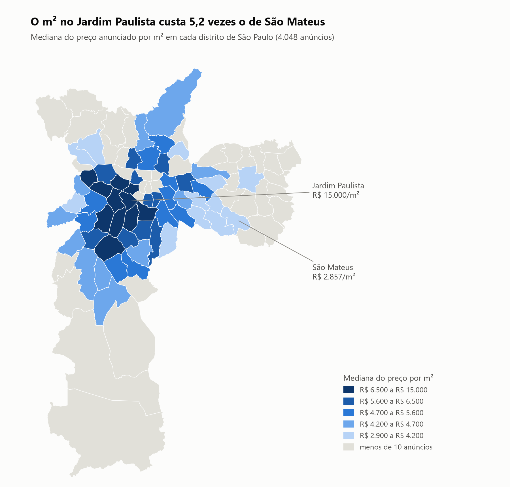
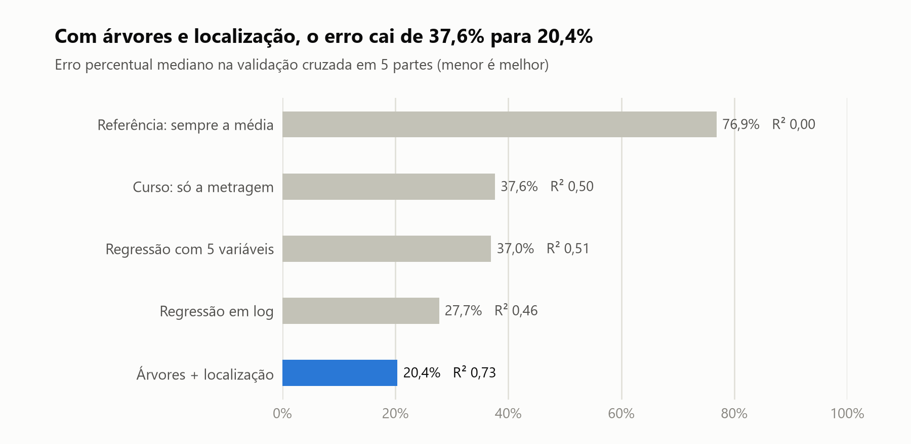
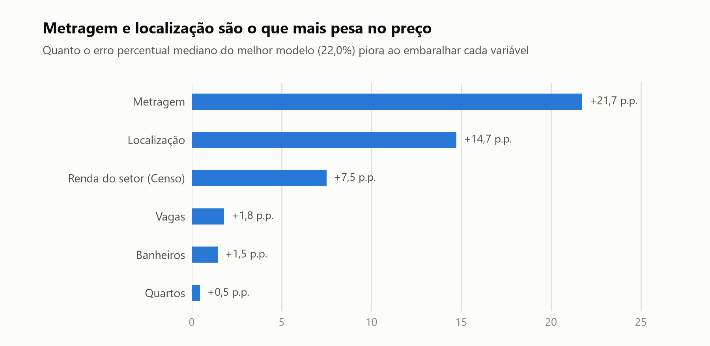

# Data Science

Projetos de ciência de dados em Python: limpeza e cruzamento de bases, dados geoespaciais, modelagem e avaliação de modelos.

## O que explica o preço dos imóveis à venda em São Paulo?

📓 **[Notebook completo](imoveis-sp/analise_precos_imoveis_sp.ipynb)**

O projeto começou na Imersão Dados da Alura (veja [como o projeto começou](#como-o-projeto-começou)). Lá, anúncios de casas à venda em São Paulo foram limpos, geolocalizados e cruzados com o Censo do IBGE, e uma regressão linear pela metragem chegou a um R² de 0,13. Aqui eu retomo essa base para responder à pergunta com mais cuidado: reviso a qualidade dos dados, faço um mapa de preços por distrito, comparo modelos com validação cruzada e meço o que mais pesa no preço.

<picture>
  <source media="(prefers-color-scheme: dark)" srcset="imoveis-sp/img/mapa_preco_m2_distrito_escuro.png">
  
</picture>

### Principais resultados

- **A qualidade dos dados pesava mais do que a escolha do modelo.** A base tinha 1.235 grupos de anúncios duplicados, quase sempre com a metragem alterada em 5 m², e um sítio de 37.000 m² que é, na verdade, a área de um terreno rural. Só esse sítio derrubava o R² do modelo do curso de 0,42 para 0,13.
- **A localização muda tudo.** A mediana do preço por m² vai de R$ 2.857 em São Mateus a R$ 15.000 no Jardim Paulista, 5,2 vezes mais.
- **Em metade dos imóveis, o melhor modelo erra menos de 20,4% do preço.** É um modelo de árvores de decisão (gradient boosting) com latitude e longitude. A regressão do curso, avaliada da mesma forma, erra menos de 37,6% em metade dos imóveis.
- **Metragem, localização e renda do entorno explicam a maior parte do preço.** Quartos, banheiros e vagas acrescentam pouco quando essas três já estão no modelo.

<picture>
  <source media="(prefers-color-scheme: dark)" srcset="imoveis-sp/img/comparacao_modelos_escuro.png">
  
</picture>

| Modelo (validação cruzada em 5 partes, 4.048 anúncios) | Erro percentual mediano | Erro médio absoluto | R² |
|---|---|---|---|
| Referência: prevê sempre a média | 76,9% | R$ 1,98 mi | 0,00 |
| Curso: regressão linear só com a metragem | 37,6% | R$ 1,20 mi | 0,50 |
| Regressão com metragem, quartos, banheiros, vagas e renda do setor | 37,0% | R$ 1,18 mi | 0,51 |
| A mesma regressão, com log no preço, na metragem e na renda | 27,7% | R$ 1,08 mi | 0,46 |
| **Árvores (gradient boosting) + latitude e longitude** | **20,4%** | **R$ 0,76 mi** | **0,73** |

<picture>
  <source media="(prefers-color-scheme: dark)" srcset="imoveis-sp/img/importancia_variaveis_escuro.png">
  
</picture>

O notebook também mostra:
- como as duplicatas tornariam a avaliação otimista (erro de 18,4% em vez de 20,4%);
- o efeito do sítio de 37.000 m² sobre a reta do curso;
- um exemplo de erro de geolocalização herdado do curso;
- as limitações da análise: preço de anúncio, Censo de 2010, amostra concentrada nas zonas sul e oeste.

**Técnicas:** pandas, GeoPandas (leitura filtrada de shapefile, `dissolve`, reprojeção para SIRGAS 2000 / UTM 23S, mapa coroplético), scikit-learn (`cross_validate`, `KFold`, `TransformedTargetRegressor`, `ColumnTransformer`, `HistGradientBoostingRegressor`, métrica própria com `make_scorer`, importância por permutação) e Matplotlib.

**Bases de dados**
- Anúncios: [House Price Data of São Paulo (Kaggle)](https://www.kaggle.com/datasets/kaggleshashankk/house-price-data-of-sao-paulo).
- Censo Demográfico 2010 do IBGE: dados agregados por setor censitário e malha de setores de SP.
- A base cruzada, saída do curso, é a [dados_vendas_censo.csv](Imersão%20ALURA/05/dados_vendas_censo.csv), e a malha de setores está em [sp_setores_consitarios/](Imersão%20ALURA/04/sp_setores_consitarios/).

### Como o projeto começou

A base foi construída ao longo das cinco aulas da [Imersão Dados da Alura](Imersão%20ALURA/). Os scripts das aulas são exportações do Google Colab e ficam no repositório como registro do curso.

| Aula | Tema | O que foi feito | Técnicas e bibliotecas |
|------|------|-----------------|------------------------|
| [01](Imersão%20ALURA/01/pandas_01.py) | Primeiros passos com pandas | Leitura da base de anúncios, filtros por bairro, médias e contagens, gráfico dos bairros com mais anúncios | `pandas`: `read_csv`, máscaras booleanas, `value_counts`, `plot.bar` |
| [02](Imersão%20ALURA/02/02.py) | Limpeza e distribuição de preços | O texto do preço (`"R$ 7.000.000"`) é separado em moeda, valor e tipo de anúncio; os aluguéis são descartados; o valor vira número; distribuição dos preços em histograma | `str.split(expand=True)`, `astype`, `describe`, `seaborn.histplot` |
| [03](Imersão%20ALURA/03/03.py) | Preço por m² e comparação entre bairros | Cálculo do valor do m², agrupamento por bairro e comparação dos 10 bairros com mais anúncios | `groupby`, `query`, `seaborn.barplot`, `boxplot` |
| [04](Imersão%20ALURA/04/04.py) | Dados geoespaciais e Censo IBGE | Os endereços dos anúncios ganham latitude e longitude; cada imóvel é localizado no seu setor censitário (ponto dentro de polígono); os dados socioeconômicos do Censo são acrescentados | `merge`, regex com `str.extract`, `geopandas`, `shapely` (`Point`, `Polygon`) |
| [05](Imersão%20ALURA/05/05.py) | Correlação e machine learning | Remoção de outliers de preço, mapa de calor das correlações entre as variáveis e regressão linear do preço em função da metragem | `numpy`, `seaborn.heatmap`, `scikit-learn` (`LinearRegression`, `train_test_split`, `mean_absolute_error`) |

Cada aula tem também um arquivo `.txt` com links de referência do curso (documentação, artigos e dicionário de dados do IBGE).

## Como executar

O notebook já está salvo com todas as saídas: dá para ler direto no GitHub. Para executá-lo de novo:

```bash
pip install -r requirements.txt
jupyter nbconvert --to notebook --execute --inplace imoveis-sp/analise_precos_imoveis_sp.ipynb
```

Também é possível abri-lo no Jupyter ou no VS Code. Ele lê os dados das pastas do curso por caminhos relativos e regenera os gráficos em [imoveis-sp/img/](imoveis-sp/img/).

Os scripts das aulas não são reproduzíveis sem ajustes:
- Leem arquivos de um caminho do Google Drive.
- Foram escritos para o pandas 1.x.
- A aula 04 depende de `enderecos.csv` e `dados_geo.csv`, que não estão no repositório; o link está em [materiais.txt](Imersão%20ALURA/04/materiais.txt).

## Estrutura

```
data-science/
├── imoveis-sp/                 # projeto: notebook com a análise completa
│   ├── analise_precos_imoveis_sp.ipynb
│   └── img/                    # gráficos usados neste README (tema claro e escuro)
├── Imersão ALURA/              # Imersão Dados – Alura (registro do curso)
│   ├── 01/ … 05/               # uma pasta por aula: script .py, dados e links de referência
│   └── .idea/                  # configuração do projeto no PyCharm
└── requirements.txt
```

## Licença

[MIT](LICENSE)
